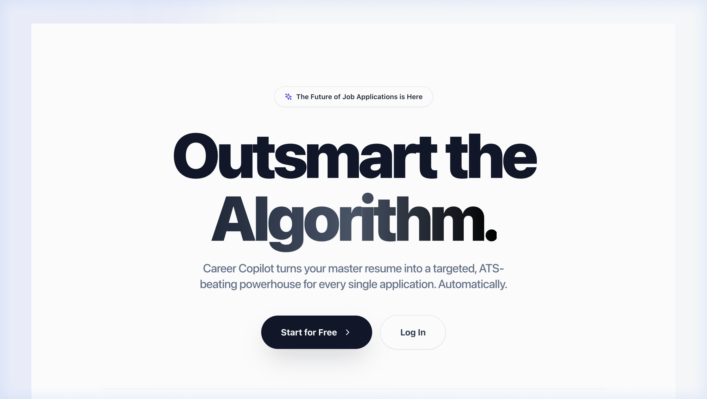
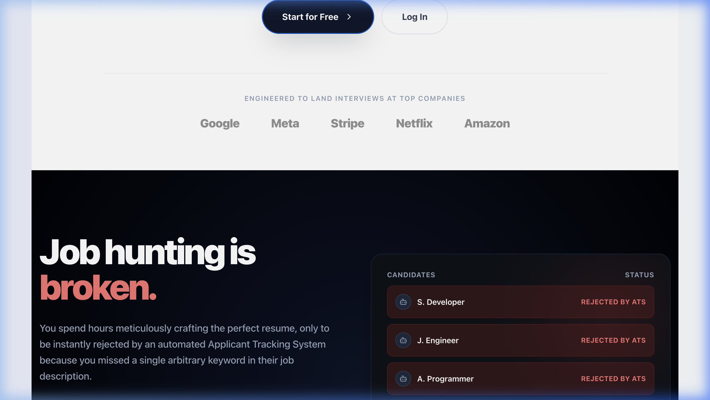
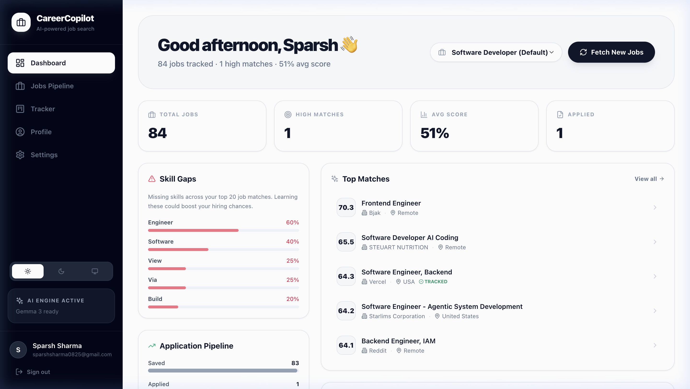
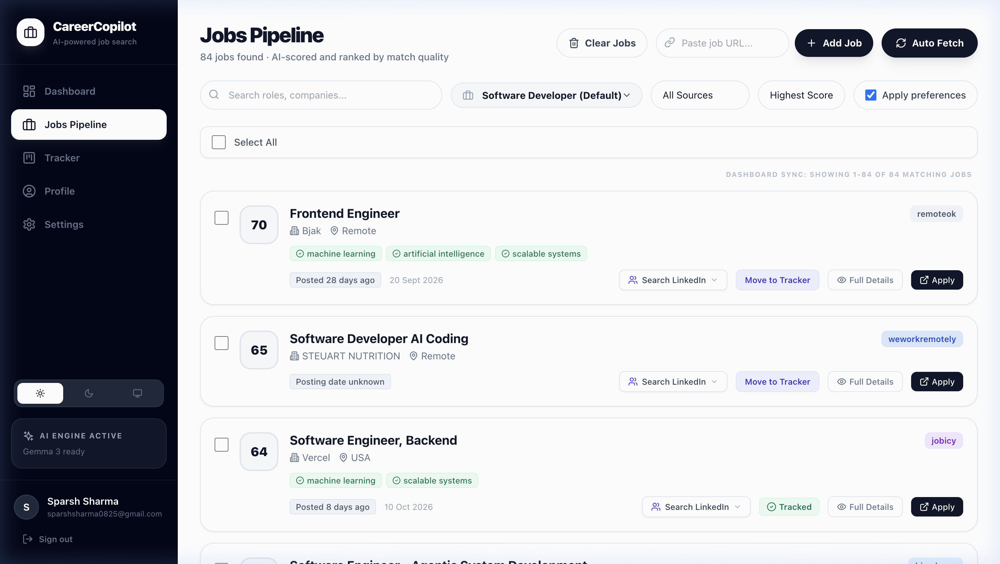
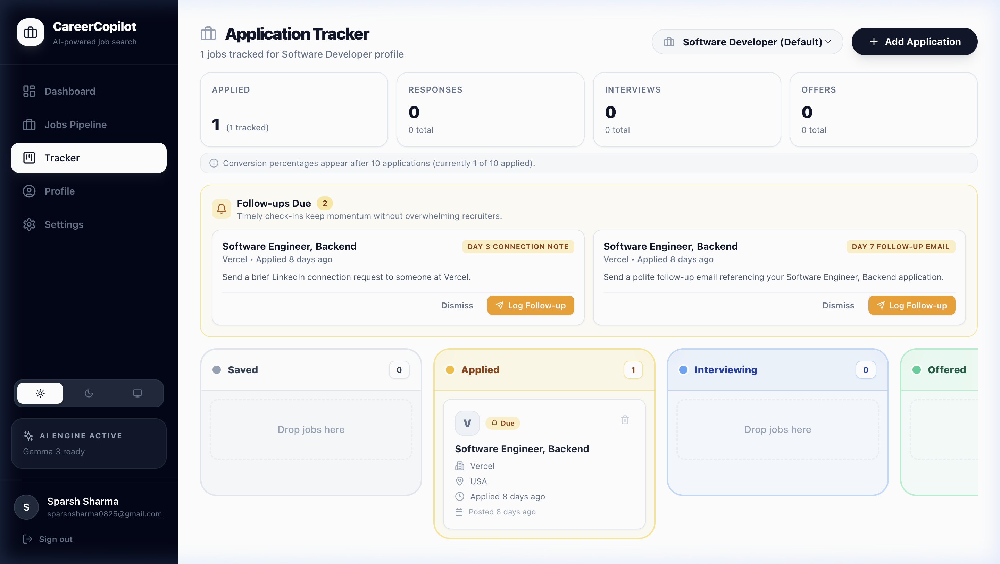
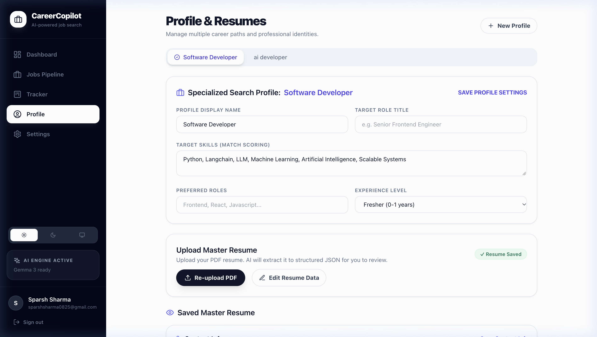

<div align="center">

# 🚀 CareerCopilot
### *Autonomous AI-Powered Job Discovery, Semantic Match Scoring & ATS Application Suite*

[](https://www.python.org/)
[](https://fastapi.tiangolo.com/)
[](https://nextjs.org/)
[](https://www.typescriptlang.org/)
[](https://tailwindcss.com/)
[](https://docs.celeryq.dev/)
[](https://www.docker.com/)
[](https://docs.pytest.org/)
[](LICENSE)

<br/>

**CareerCopilot** is an open-source, multi-tenant career management platform designed to shift job hunting from high-volume spam to surgical precision. It aggregates opportunities from multiple global job boards, semantically scores every role against specialized candidate profiles, tailors ATS-optimized resumes using verified non-hallucinatory impact metrics, and keeps your search moving forward with automated follow-up cadences and mathematical funnel analytics.

[Explore Features](#-key-features) • [Visual Showcase](#-visual-showcase) • [Architecture](#-system-architecture) • [Quickstart Guide](#-quick-start) • [API Reference](#-api-reference)

---

</div>

## 📑 Table of Contents

- [The Problem & The Solution](#-the-problem--the-solution)
- [Visual Showcase](#-visual-showcase)
- [Key Features](#-key-features)
- [System Architecture](#-system-architecture)
- [Tech Stack](#-technology-stack)
- [Quick Start](#-quick-start)
  - [Prerequisites](#prerequisites)
  - [Option A: Docker Compose (Recommended)](#option-a-docker-compose-recommended)
  - [Option B: Local Development](#option-b-local-development)
- [Configuration Reference](#-configuration-reference)
- [API Reference](#-api-reference)
- [Automated Testing](#-testing--code-quality)
- [Project Directory Layout](#-project-directory-layout)
- [Engineering Principles](#-engineering-principles)
- [Contributing](#-contributing)
- [License](#-license)

---

## 💡 The Problem & The Solution

| The Old Way: Spray & Pray | The CareerCopilot Way: High Signal |
|:---|:---|
| **Asymmetric Automation**: Recruiters filter with automated ATS bots while candidates manually copy-paste applications for hours. | **Semantic Match Scoring**: Multi-vector evaluation (semantic similarity, keyword overlap, experience tier, and posting recency) scores jobs from 0–100%. |
| **Hallucinated Resumes**: Generic AI tools fabricate metrics, fictitious job titles, and unearned achievements that fall apart in interviews. | **Grounded Impact Engine**: Resumes are synthesized strictly from user-verified achievements and real source experience—zero hallucinations. |
| **Lost In The Black Hole**: Applications get submitted into silence; candidates forget when to follow up or when to move on. | **Automated Cadence Nudges**: Timed alerts for Day 3 connection notes, Day 7 follow-ups, and Day 21 ghosted confirmations keep momentum. |
| **One-Size-Fits-None Persona**: A single master resume fails to capture multi-faceted careers across backend, AI, or full-stack paths. | **Multi-Profile Isolation**: Clean architectural separation between global candidate preferences and specialized role-based scoring profiles. |

---

## 📸 Visual Showcase

### 1. Interactive Landing & Onboarding
Engaging hero section with storytelling animations, value propositions, and interactive workflow guides.

<p align="center">
  
</p>

<p align="center">
  
</p>

---

### 2. Live Command Dashboard
Real-time birds-eye overview tracking total jobs, high matches, average score, skill gap distribution, and active recruitment funnel status.

<p align="center">
  
</p>

---

### 3. Multi-Source Jobs Pipeline & Scoring
Aggregated multi-board feed with instant search, multi-faceted filtering, match badges, and single-click tracker progression.

<p align="center">
  
</p>

---

### 4. Application Tracker with Dynamic Follow-Up Cadence
Kanban-style tracking across all pipeline stages with persistent follow-up alerts (Day 3 note, Day 7 email) and conversion benchmarks.

<p align="center">
  
</p>

---

### 5. Multi-Persona Profile & Master Resume Management
Manage distinct career personas (e.g. *Software Developer*, *AI Engineer*), skill priority lists, and structured PDF master resumes.

<p align="center">
  
</p>

---

## ✨ Key Features

### 🔍 Automated Job Scraping & Aggregation
- **Multi-Board Harvesters**: Built-in parsers for **RemoteOK**, **Jobicy**, **Himalayas**, **WeWorkRemotely**, **Instahyre**, and **TheMuse**.
- **Custom Link Ingestion**: Parse and extract structured requirements from any arbitrary job posting URL or raw text snippet using Playwright and BeautifulSoup.
- **Deduplication Engine**: Hash-based external ID tracking prevents duplicate job postings across crawls.

### 🧠 Grounded Semantic Scoring Engine
- **Hybrid Scorer**: Blends sentence-transformer vector embeddings, precise technical keyword matching, location compatibility, and experience tier verification.
- **Recency Decay**: Fresh job postings receive time-weighted scoring bonuses to ensure early applicant advantage.
- **Skill Gap Insights**: Automatically surfaces the most common missing keywords across your top-matching jobs so you know exactly which competencies to upskill.

### 📄 Anti-Hallucinatory ATS Resume & Cover Letter Generation
- **Fact-Grounded Synthesis**: LLM generation (via local Ollama **Gemma 3** or **OpenAI**) is strictly constrained to your parsed master resume and verified **Grounded Impact Store**.
- **No Inventions**: Zero fabricated employers, dates, or metrics. Every bullet point is mathematically grounded in facts you approved.
- **Dual Export**: Generates clean, ATS-compliant PDF and DOCX files ready for direct employer submission.

### 🗂️ Interactive Kanban Board & Audit Timeline
- **DnD-Kit Drag & Drop**: Fluid stage management: `Saved` ➔ `Applied` ➔ `Interviewing` ➔ `Offered` ➔ `Rejected / Ghosted`.
- **Immutable Audit Log**: Every stage transition, follow-up, note, and contact attempt is logged chronologically to the application's audit timeline.
- **Follow-up Cadence**:
  - **Day 3**: LinkedIn connection note recommendation.
  - **Day 7**: Polite follow-up email nudge.
  - **Day 14**: Secondary check-in prompt.
  - **Day 21+**: Suggests marking the application as ghosted with explicit modal confirmation.
  - **Persistent Dismissal**: Dismissed alerts stay silenced permanently.

### 📊 Pure Mathematical Funnel Analytics
- **Truthful Metrics**: Calculates real conversion rates strictly against submitted applications (`Applied` ➔ `Interviewing` ➔ `Offer`).
- **Small-Sample Guard**: Suppresses misleading percentage swings until at least 10 applications have been submitted.

### 🔐 Multi-Tenant Security & Extensibility
- **JWT Authentication**: Secure Bearer tokens with separate refresh token rotation.
- **Password Security**: Bcrypt-hashed credentials and tokenized email verification workflows.
- **Isolated User Context**: Complete database row-level multi-tenancy isolating profiles, resumes, and tracked metrics per account.

---

## 🏗️ System Architecture

```
┌─────────────────────────────────────────────────────────────────────────────────┐
│                           Client Tier (Next.js 14)                              │
│   React 18  •  Tailwind CSS  •  Framer Motion  •  DnD-Kit  •  Lucide UI         │
└────────────────────────────────────────┬────────────────────────────────────────┘
                                         │ REST API (Bearer JWT)
                                         ▼
┌─────────────────────────────────────────────────────────────────────────────────┐
│                       Application Tier (FastAPI Backend)                        │
│                                                                                 │
│  ┌──────────────────────┐ ┌──────────────────────┐ ┌─────────────────────────┐  │
│  │   Auth & Accounts    │ │   Job Aggregator     │ │    Scoring Engine       │  │
│  │  • JWT Auth/Refresh  │ │  • Scrapers (RemoteOK│ │  • Cosine Similarity    │  │
│  │  • Email Verification│ │    Jobicy, Himalayas)│ │  • Keyword Matchers     │  │
│  │  • Multi-Tenant DB   │ │  • Custom URL Parser │ │  • Recency Decay Curve  │  │
│  └──────────────────────┘ └──────────────────────┘ └─────────────────────────┘  │
│  ┌──────────────────────┐ ┌──────────────────────┐ ┌─────────────────────────┐  │
│  │  Application Tracker │ │   Cadence Engine     │ │   LLM Resume Tailor     │  │
│  │  • Kanban Pipelines  │ │  • Day 3/7/14 Nudges │ │  • Anti-Hallucination   │  │
│  │  • Audit Timelines   │ │  • Ghosted Resolver  │ │  • Grounded Metrics     │  │
│  │  • Funnel Analytics  │ │  • Safe Dismissals   │ │  • PDF/DOCX Exporter    │  │
│  └──────────────────────┘ └──────────────────────┘ └─────────────────────────┘  │
└─────────────────────┬──────────────────────────┬────────────────────────────────┘
                      │                          │
        Database / ORM│                          │Task Dispatch
                      ▼                          ▼
┌──────────────────────────────┐        ┌─────────────────────────────────────────┐
│       Persistence Tier       │        │         Asynchronous Workers            │
│  SQLite (Dev) / PostgreSQL   │        │  Celery Workers  •  Redis Broker        │
│  • Alembic Versioned Schemas │        │  • Scheduled Periodic Scrapes           │
│  • Candidate vs Resume Split │        │  • Headless Playwright Ingestion        │
└──────────────────────────────┘        └─────────────────────────────────────────┘
```

### 📐 Invariant Architecture Rules

CareerCopilot enforces strict separation between candidate preferences and role profiles:

1. **`CandidateProfile` (Global Search Invariants)**:
   - Holds search and filtering constraints: `remote_preference`, `min_salary`, `salary_currency`, `preferred_locations`, and `target_companies`.
   - `GET /jobs` reads **filters** strictly from this table.
2. **`ResumeProfile` (Scoring & Tailoring Invariants)**:
   - Holds persona attributes: `name`, `role_title`, `target_skills`, `experience_level`, and parsed `master_resume`.
   - `GET /jobs` computes **scores** strictly using the active `ResumeProfile`.
   - Filters must **never** be copied or duplicated into `ResumeProfile`.

---

## 🛠️ Technology Stack

| Layer | Technologies |
|:---|:---|
| **Frontend** | [Next.js 14](https://nextjs.org/) (App Router), [React 18](https://react.dev/), [TypeScript](https://www.typescriptlang.org/), [Tailwind CSS](https://tailwindcss.com/), [Framer Motion](https://www.framer.com/motion/), [DnD-Kit](https://dndkit.com/), [Lucide Icons](https://lucide.dev/), [Sonner](https://sonner.emilkowal.ski/) |
| **Backend** | [Python 3.9+](https://www.python.org/), [FastAPI](https://fastapi.tiangolo.com/), [Uvicorn](https://www.uvicorn.org/), [SQLAlchemy](https://www.sqlalchemy.org/), [Alembic](https://alembic.sqlalchemy.org/), [Pydantic v2](https://docs.pydantic.dev/), [PyJWT](https://pyjwt.readthedocs.io/), [Passlib](https://passlib.readthedocs.io/) |
| **AI & NLP** | Local [Ollama](https://ollama.ai/) (**Gemma 3:12b**) / [OpenAI API](https://openai.com/), [HuggingFace Transformers](https://huggingface.co/), [Sentence-Transformers](https://www.sbert.net/), [scikit-learn](https://scikit-learn.org/) |
| **Worker & Automation** | [Celery](https://docs.celeryq.dev/), [Redis](https://redis.io/), [Playwright](https://playwright.dev/python/), [BeautifulSoup4](https://www.crummy.com/software/BeautifulSoup/) |
| **Storage & Export** | [SQLite](https://www.sqlite.org/) (Local Dev), [PostgreSQL 15](https://www.postgresql.org/) (Production), [ReportLab](https://www.reportlab.com/) (PDF), [python-docx](https://python-docx.readthedocs.io/) (DOCX) |
| **Infrastructure** | [Docker](https://www.docker.com/), [Docker Compose](https://docs.docker.com/compose/), [Nginx](https://nginx.org/) |

---

## 🚀 Quick Start

### Prerequisites

- **Node.js** 18.x or 20.x
- **Python** 3.9+ (Python 3.10 or 3.11 recommended)
- **Git**
- *(Optional)* **Docker & Docker Compose**
- *(Optional for Local AI)* [Ollama](https://ollama.ai/) installed and running (`ollama run gemma3:12b`)

---

### Option A: Docker Compose (Recommended)

Run the full stack (Frontend, Backend, PostgreSQL, Redis, Celery Worker, Nginx) in containers:

```bash
# 1. Clone repository
git clone https://github.com/sparsh-sharma-08/jobApplierAI.git
cd jobApplierAI

# 2. Copy environment templates
cp backend/.env.example backend/.env
cp frontend/.env.example frontend/.env.local

# 3. Build and start containers
docker compose up --build
```

- **Frontend App**: `http://localhost:3000`
- **Backend API**: `http://localhost:8000`
- **Interactive Swagger Docs**: `http://localhost:8000/docs`

---

### Option B: Local Development

#### 1. Backend Setup (FastAPI)

```bash
# Navigate to backend directory
cd backend

# Create and activate Python virtual environment
python3 -m venv .venv
source .venv/bin/activate       # On Windows: .venv\Scripts\activate

# Install dependencies
pip install -r requirements.txt

# Configure environment
cp .env.example .env

# Apply database migrations
alembic upgrade head

# Launch development server
uvicorn main:app --reload --reload-exclude '*.venv*' --port 8000
```
Backend API will be running at **`http://127.0.0.1:8000`**.

#### 2. Celery Worker (Optional for background scraping)

In a separate terminal:
```bash
cd backend
source .venv/bin/activate
celery -A core.tasks worker --pool=solo --loglevel=info
```

#### 3. Frontend Setup (Next.js 14)

In another terminal:
```bash
# Navigate to frontend directory
cd frontend

# Install dependencies
npm install

# Configure environment
cp .env.example .env.local

# Run Next.js in development mode
npm run dev
```
Web application will be accessible at **`http://localhost:3000`**.

---

## ⚙️ Configuration Reference

### Backend (`backend/.env`)

| Variable | Default Value | Description |
|:---|:---|:---|
| `DATABASE_URL` | `sqlite:///./data/career_copilot.db` | Database connection string (SQLite or PostgreSQL) |
| `SECRET_KEY` | *(Required)* | Secret key used for signing JWT tokens |
| `FRONTEND_URL` | `http://localhost:3000` | Allowed frontend origin for CORS and email links |
| `LLM_MODEL` | `gemma3:12b` | Target model name (`gemma3:12b`, `gpt-4o-mini`, etc.) |
| `LLM_BASE_URL` | `http://localhost:11434/v1` | LLM API base URL (`http://localhost:11434/v1` for Ollama) |
| `OPENAI_API_KEY` | `ollama-dummy-key` | API Key for LLM provider (or dummy key for local Ollama) |
| `CELERY_BROKER_URL`| `redis://localhost:6379/0` | Redis broker URL for Celery background tasks |
| `REDIS_URL` | `redis://localhost:6379/0` | Redis instance URL |
| `DAILY_LIMIT` | `20` | Max job discovery actions allowed per 24 hours |
| `OUTPUT_DIR` | `./data/resumes` | Directory path where generated resumes are exported |
| `SMTP_HOST` | `smtp.gmail.com` | SMTP host for verification and password reset emails |
| `SMTP_PORT` | `587` | SMTP port |
| `SMTP_USER` | *(Optional)* | SMTP user account |
| `SMTP_PASS` | *(Optional)* | SMTP app password |

### Frontend (`frontend/.env.local`)

| Variable | Default Value | Description |
|:---|:---|:---|
| `NEXT_PUBLIC_API_URL` | `http://127.0.0.1:8000` | Base URL of the backend REST API |

---

## 🔌 API Reference

Interactive OpenAPI documentation and live playground are available at:
`http://localhost:8000/docs` (Swagger UI) or `http://localhost:8000/redoc` (ReDoc).

### Authentication & Users
| Method | Endpoint | Description |
|:---|:---|:---|
| `POST` | `/auth/register` | Register a new user account |
| `POST` | `/auth/login` | Authenticate with credentials and receive JWT access/refresh tokens |
| `POST` | `/auth/refresh` | Exchange refresh token for new access token |
| `POST` | `/auth/forgot-password` | Request password reset verification link |
| `POST` | `/auth/reset-password` | Set new password with verified reset token |
| `GET` | `/auth/verify-email` | Verify email address from token |

### Profiles & Resumes
| Method | Endpoint | Description |
|:---|:---|:---|
| `GET` | `/profile` | Retrieve candidate profile and active resume data |
| `POST` | `/profile` | Create or update candidate search preferences |
| `POST` | `/profile/upload-resume` | Upload master resume PDF; extracts structured JSON data |
| `GET` | `/resume-profiles` | List all specialized resume profiles for current user |
| `POST` | `/resume-profiles` | Create a new specialized resume persona |
| `PUT` | `/resume-profiles/{id}` | Update targeted skills and attributes for a profile |
| `DELETE` | `/resume-profiles/{id}` | Remove a resume profile |

### Job Pipeline & Matching
| Method | Endpoint | Description |
|:---|:---|:---|
| `GET` | `/jobs` | List aggregated jobs scored against candidate's profile |
| `POST` | `/jobs/fetch` | Trigger scrapers across configured job boards |
| `POST` | `/jobs/parse` | Ingest and parse arbitrary job URL or raw text |
| `GET` | `/jobs/{id}` | Retrieve comprehensive job description and match breakdown |
| `POST` | `/jobs/{id}/tailor-resume`| Generate tailored ATS resume and cover letter |
| `GET` | `/jobs/{id}/export-resume`| Export tailored resume as PDF or DOCX |

### Applications, Kanban & Follow-ups
| Method | Endpoint | Description |
|:---|:---|:---|
| `GET` | `/applications` | List all tracked applications with current status |
| `POST` | `/applications` | Track an opportunity into the pipeline |
| `PATCH` | `/applications/{id}` | Update application status (`saved`, `applied`, `interviewing`, `offered`, `rejected`, `ghosted`) |
| `GET` | `/applications/follow-ups` | Fetch active follow-up cadence reminders |
| `POST` | `/applications/follow-ups/dismiss`| Persistently dismiss a follow-up alert |
| `GET` | `/applications/{id}/events` | Fetch complete immutable chronological timeline |
| `POST` | `/applications/{id}/events` | Append note or interaction event to timeline |
| `GET` | `/applications/analytics` | Fetch mathematical funnel conversion rates |

### Grounded Impact Metrics
| Method | Endpoint | Description |
|:---|:---|:---|
| `GET` | `/impact-metrics` | Retrieve user-verified quantitative achievements |
| `POST` | `/impact-metrics` | Record new verified accomplishment metrics for LLM grounding |

---

## 🧪 Testing & Code Quality

CareerCopilot comes with a comprehensive test suite verifying the scoring algorithms, follow-up cadence logic, candidate profile isolation, and API endpoints.

```bash
# Run the complete test suite (125 tests)
backend/.venv/bin/pytest backend/tests/ -v

# Run specific domain test modules
backend/.venv/bin/pytest backend/tests/test_application_funnel.py
backend/.venv/bin/pytest backend/tests/test_follow_up.py
backend/.venv/bin/pytest backend/tests/test_preference_filter.py
backend/.venv/bin/pytest backend/tests/test_api.py
```

### Frontend Validation & Build

```bash
cd frontend
npm run lint
npm run build
```

---

## 📁 Project Directory Layout

```
jobApplierAI/
├── backend/
│   ├── alembic/                 # Versioned database migration scripts
│   ├── core/
│   │   ├── celery_app.py        # Celery task queue initialization
│   │   └── tasks.py             # Periodic background scraping tasks
│   ├── models/
│   │   ├── database.py          # SQLAlchemy ORM database models
│   │   └── schemas.py           # Pydantic request/response validation schemas
│   ├── scrapers/                # Web harvesters (RemoteOK, Himalayas, Jobicy, etc.)
│   ├── services/
│   │   ├── follow_up.py         # Deterministic follow-up cadence calculation
│   │   ├── llm_service.py       # Anti-hallucinatory LLM resume synthesizer
│   │   ├── resume_exporter.py   # PDF and DOCX compilation engine
│   │   └── scorer.py            # Hybrid semantic & keyword matching engine
│   ├── tests/                   # Pytest test suite (funnel, cadence, API)
│   ├── .env.example             # Backend environment variable template
│   ├── Dockerfile               # Backend container recipe
│   ├── main.py                  # FastAPI application entrypoint & routing
│   └── requirements.txt         # Python dependencies
├── docs/
│   └── screenshots/             # Production application visual assets
├── frontend/
│   ├── src/
│   │   ├── app/
│   │   │   ├── (dashboard)/
│   │   │   │   ├── dashboard/   # High-level overview & analytics widgets
│   │   │   │   ├── jobs/        # Multi-source job pipeline & scoring
│   │   │   │   ├── profile/     # Multi-profile & resume management
│   │   │   │   ├── settings/    # Search preferences & board toggles
│   │   │   │   └── tracker/     # Kanban board & follow-up cadence UI
│   │   │   ├── layout.tsx       # Root Next.js layout & theme providers
│   │   │   └── page.tsx         # Landing page & authentication flow
│   │   ├── components/          # Reusable UI components & dialogs
│   │   ├── hooks/               # Custom React hooks (settings, profiles)
│   │   └── lib/                 # API client & fetch wrappers
│   ├── .env.example             # Frontend environment variable template
│   ├── Dockerfile               # Frontend container recipe
│   ├── package.json             # Node dependencies and scripts
│   └── tailwind.config.js       # Design tokens & color system
├── docker-compose.yml           # Full-stack container orchestration
├── docker-compose.prod.yml      # Production container deployment
└── README.md                    # Project documentation
```

---

## 🛡️ Engineering Principles

1. **Zero Fabrication Guarantee**: The AI resume tailoring engine strictly adheres to ground-truth data from your master resume and verified Impact Store. It will never invent company names, metrics, titles, or technical claims.
2. **Real Conversion Math**: We never show artificial or inflated funnel statistics. Conversion metrics are derived directly from real user submissions, protected against small-sample skew.
3. **User Agency**: Automation serves the user, not the other way around. Important state changes (such as declaring an unresponsive application *Ghosted*) always require explicit user confirmation.
4. **Data Isolation**: Multi-tenant architecture guarantees that your candidate profiles, resumes, and private job applications remain strictly isolated.

---

## 🤝 Contributing

Contributions make the open-source community an inspiring place to learn, inspire, and create. Any contributions you make are **greatly appreciated**.

1. Fork the Project
2. Create your Feature Branch (`git checkout -b feature/AmazingFeature`)
3. Commit your Changes (`git commit -m 'Add some AmazingFeature'`)
4. Ensure all tests pass (`pytest backend/tests/`)
5. Push to the Branch (`git push origin feature/AmazingFeature`)
6. Open a Pull Request

---

## 📄 License

Distributed under the MIT License. See `LICENSE` for more information.

---

<div align="center">
  <sub>Built with ❤️ for focused, high-impact job seekers everywhere.</sub>
</div>
